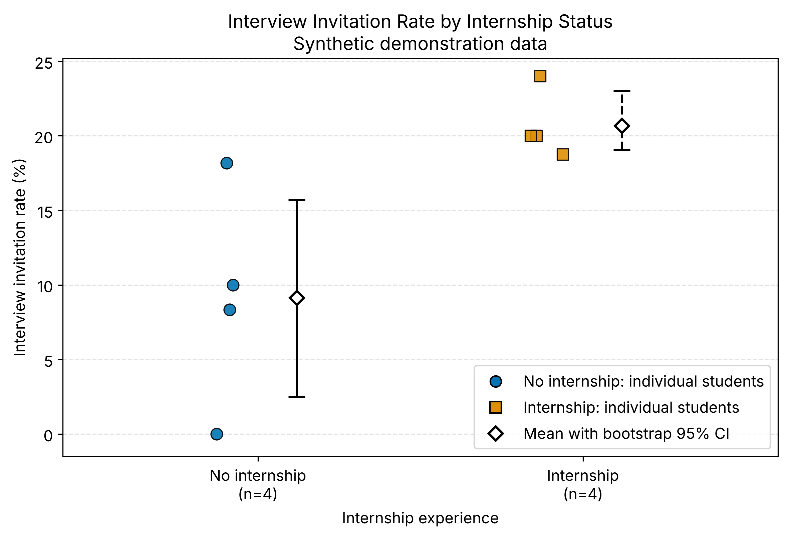
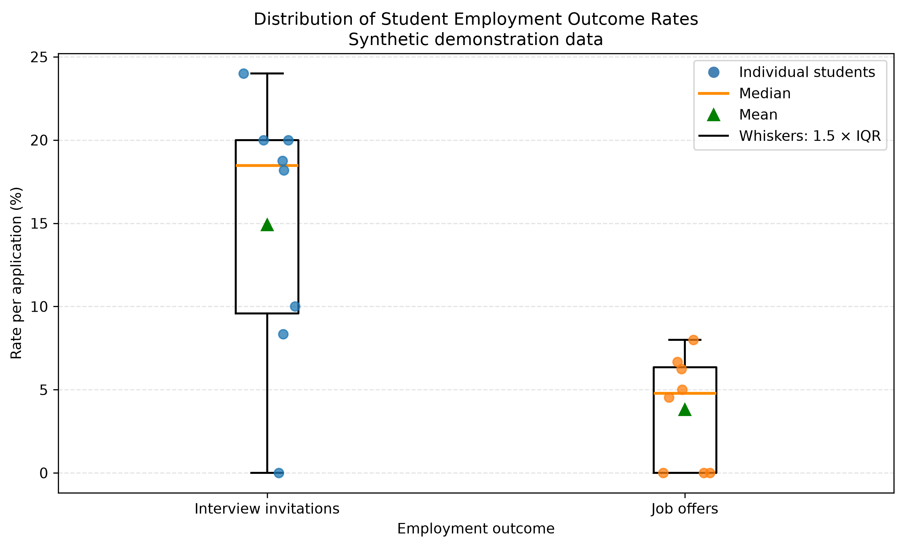

# IT Student Employability Research

**Authors:** Rakhimzhanova Yasmina and Utebayeva Anel

## 1. Overview

This project investigates factors associated with the employability of IT students who have little or no professional work experience.

The research focuses on the role of professional experience, academic projects, internships, technical skills, and communication skills in students' employment prospects.

The repository provides a reproducible data-analysis workflow, including data validation, descriptive statistics, data-quality checks, a domain model, and scientific visualizations.

**Data status:** The current dataset contains eight synthetic demonstration records. All results are preliminary pipeline-testing outputs, not empirical evidence about the student population.

## 2. Research Questions

- **RQ1:** What factors are associated with difficulties in finding a first IT job among students with little or no professional experience?
- **RQ2:** How are academic projects and internships associated with employment-related outcomes?
- **RQ3:** How are technical and communication skills associated with employment-related outcomes?

## 3. Research Hypotheses

The following hypotheses are based on the earlier project work:

- **H1:** Lack of professional experience is associated with greater difficulty finding a first job.
- **H2:** Students with practical experience from academic projects or internships have better employment prospects.
- **H3:** Higher technical and communication skills are associated with better employment prospects.

The corresponding null hypotheses state that there is no association between the respective factors and employment-related outcomes.

These hypotheses have **not been empirically tested** using real student data. The current synthetic dataset is insufficient to draw conclusions about the hypotheses.

## 4. Dataset and Variables

The demonstration dataset is stored in `data/sample/sample.csv`.

It contains eight synthetic records and includes the following variables:

| Variable | Description |
|---|---|
| `student_id` | Synthetic record identifier |
| `professional_experience` | Whether professional experience is reported |
| `academic_projects` | Number of academic projects |
| `internship` | Whether internship experience is reported |
| `technical_skills` | Technical skills score |
| `communication_skills` | Communication skills score |
| `applications_sent` | Number of job applications |
| `interview_invitations` | Number of interview invitations |
| `job_offers` | Number of job offers |

The records are artificial and do not represent actual students. They are used to validate the analysis pipeline and demonstrate the expected outputs.

The directory `data/raw/` is excluded from Git (see `.gitignore`); only the small sample and the processed summary `data/processed/metrics_summary.csv` are committed.

## 5. Methodology

The analysis workflow consists of the following stages:

1. Load the sample dataset.
2. Validate required columns and record identifiers.
3. Check numeric values and consistency between applications, interview invitations, and job offers; exclude invalid records.
4. Calculate interview invitation and job offer rates.
5. Calculate descriptive statistics: mean, median, percentiles (p95, p99), and standard deviation.
6. Estimate bootstrap 95% confidence intervals for mean rates (5000 resamples).
7. Generate visualizations and export them in PNG (300 DPI) and PDF formats.
8. Save statistical summaries and data-quality results for reproducibility.

The bootstrap uses a fixed random seed (`42`) to make the calculations reproducible.

**Warm-up filtering.** The dataset consists of per-student survey-style counts, not timed benchmark runs, so there is no warm-up phase to discard. Data-quality guardrails (missing values, negative counts, invitations or offers exceeding applications) take the place of the warm-up filter.

Because the dataset contains only eight synthetic records, the percentiles and confidence intervals are illustrative and should not be interpreted as reliable population estimates.

## 6. Results & Discussion

### 6.1 Descriptive statistics

The following results were calculated from the eight synthetic demonstration records (source: `results/statistical_summary.csv`).

| Indicator | n | Mean ± SD | Median (p25–p75) | p95 | p99 | 95% bootstrap CI for mean |
|---|---:|---:|---:|---:|---:|---:|
| Interview invitation rate | 8 | 14.91% ± 8.01 | 18.47% (9.58–20.00) | 22.60% | 23.72% | 9.39%–19.87% |
| Job offer rate per application | 8 | 3.81% ± 3.32 | 4.77% (0.00–6.35) | 7.53% | 7.91% | 1.63%–5.89% |

**Definitions**

- **Interview invitation rate:** interview invitations divided by job applications for each record.
- **Job offer rate per application:** job offers divided by job applications for each record.
- **95% bootstrap confidence interval:** an interval estimated by resampling the available records to illustrate uncertainty in the sample mean.
- With n = 8, p95 and p99 are interpolated between very few points and are shown for completeness only.

### 6.2 Baseline vs. Proposed comparison

The baseline group is students **without** internship experience; the compared group is students **with** internship experience. Values are per-student rates (n = 4 per group).

| Indicator | Baseline: no internship | Proposed: internship |
|---|---:|---:|
| Interview invitation rate, Mean ± SD | 9.13% ± 7.45 | 20.69% ± 2.29 |
| Interview invitation rate, Median (p25–p75) | 9.17% (6.25–12.05) | 20.00% (19.69–21.00) |
| Job offer rate per application, Mean ± SD | 1.14% ± 2.27 | 6.48% ± 1.24 |
| Job offer rate per application, Median (p25–p75) | 0.00% (0.00–1.14) | 6.46% (5.94–7.00) |

The pooled (applications-weighted) interview invitation rate is 9.68% without internship and 21.05% with internship (`results/analysis_summary.json`).

The comparison is exploratory. With four records per group it cannot establish that internships cause better outcomes, and the groups may differ in other variables.

### 6.3 Scientific visualizations

**Figure 1. Interview invitation rate by internship status**

Individual records and group means with bootstrap 95% confidence intervals.



Vector version: [PDF](reports/figures/fig1_internship_comparison.pdf)

**Figure 2. Distribution of employment outcome rates**

Distributions of interview invitation rates and job offer rates per application, with individual records, median, and mean.



Vector version: [PDF](reports/figures/fig2_rate_distributions.pdf)

Both figures are exported as PNG at 300 DPI and as PDF.

### 6.4 Data quality

The current eight-record demonstration dataset passed the implemented checks:

| Data-quality check | Invalid records detected |
|---|---:|
| Negative applications | 0 |
| Negative interview invitations | 0 |
| Negative job offers | 0 |
| Interview invitations exceeding applications | 0 |
| Job offers exceeding applications | 0 |

These checks confirm that the sample passes the implemented validation rules. They do not establish that the data are representative or that all possible data-quality problems have been eliminated.

### 6.5 Interpretation

The pipeline successfully demonstrates data processing, descriptive statistics, bootstrap confidence intervals, data-quality checks, and figure export.

No conclusion about H1, H2, or H3 can be justified from these synthetic records. Testing the research hypotheses requires real, appropriately collected student data and a suitable statistical analysis.

## 7. Domain Model

The C4 container diagram (with the metric measurement nodes M1–M5), the entity and variable definitions, and the formal definitions of all metrics (rates, percentiles, bootstrap confidence interval, guardrails) are in [`docs/domain_model.md`](docs/domain_model.md).

The STRIDE threat model of the pipeline components is in [`docs/security_analysis.md`](docs/security_analysis.md). The research methodology is described in [`docs/methodology_passport.md`](docs/methodology_passport.md).

## 8. Baseline and Future Evaluation

The current exploratory baseline compares interview invitation rates between records with and without internship experience.

A future empirical evaluation should use a documented data-collection procedure and a sufficiently large sample of actual IT students. The analysis should define the outcome variables in advance, examine missing data, account for relevant confounding factors, and use statistical methods appropriate to the research questions and data.

The current comparison is a pipeline demonstration, not a completed empirical evaluation.

## 9. Repository Structure

```text
.
├── configs/
│   └── config.yaml
├── data/
│   ├── sample/
│   │   └── sample.csv
│   └── processed/
│       └── metrics_summary.csv
├── docs/
│   ├── domain_model.md
│   ├── methodology_passport.md
│   └── security_analysis.md
├── notebooks/
│   ├── 01_data_analysis.ipynb
│   └── README.md
├── reports/
│   └── figures/
│       ├── fig1_internship_comparison.png
│       ├── fig1_internship_comparison.pdf
│       ├── fig2_rate_distributions.png
│       └── fig2_rate_distributions.pdf
├── results/
│   ├── analysis_summary.json
│   ├── statistical_summary.csv
│   └── data_quality_summary.csv
├── src/
│   ├── benchmark.py
│   ├── process_data.py
│   ├── statistical_analysis.py
│   └── visualize.py
├── .gitignore
├── .python-version
├── requirements.txt
├── LICENSE
└── README.md
```

## 10. Reproducibility

The repository includes source scripts, a demonstration dataset, a configuration file, a Jupyter Notebook, and generated analysis outputs. All random steps use seed `42`.

Run everything from the repository root. Install the pinned dependencies:

```bash
python -m pip install -r requirements.txt
```

Run the pipeline in this order:

```bash
python src/process_data.py          # data/sample -> data/processed
python src/statistical_analysis.py  # statistics and data-quality summaries -> results/
python src/benchmark.py             # internship comparison -> results/analysis_summary.json
python src/visualize.py             # figures -> reports/figures/
```

Open the notebook and run it with **Kernel → Restart & Run All**:

```bash
jupyter notebook notebooks/01_data_analysis.ipynb
```

The current output files are retained in the repository to support inspection and reproducibility.

## 11. Limitations and Next Steps

The main limitations are:

- The current dataset contains only eight synthetic records.
- The results cannot be generalized to the student population.
- The analysis is descriptive and does not establish causality.
- The research hypotheses have not been tested on empirical data.
- The data-collection procedure and the suitability of the measures must be established before substantive conclusions can be drawn.

The next steps are to collect suitable real-world data, extend the domain model if the pipeline changes, and conduct an appropriate empirical evaluation.

## License

This project is distributed under the MIT License. See the `LICENSE` file for details.

## Citation

Rakhimzhanova, Y., and Utebayeva, A. *IT Student Employability Research*. Student research project.

Repository: https://github.com/RakhimzhanovaYasmina/it-student-employability-research
