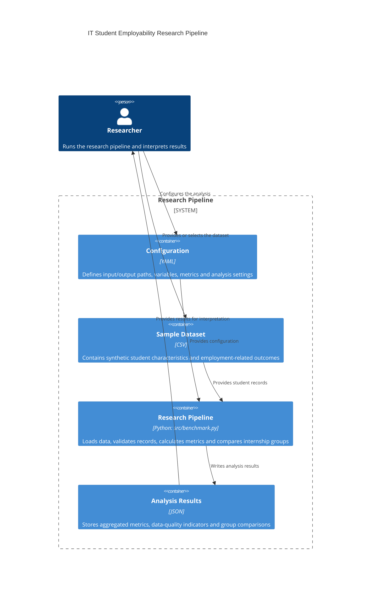

# Domain Model — IT Student Employability Research

## 1. Purpose

This domain model describes the research pipeline used to analyze factors associated with the employability of IT students with little or no professional work experience.

The pipeline loads a synthetic student dataset, validates its records, calculates employment-related metrics, compares internship groups, and saves research results.

**Data limitation:** The current dataset contains eight synthetic demonstration records. It does not represent a real student survey or measured employment outcomes.

## 2. C4-Style Container Diagram

## 3. Metric Collection Points

| Collection point | Variables or metrics | Purpose |
|---|---|---|
| Input dataset | Professional experience, academic projects, internship, technical skills, communication skills | Describes student characteristics |
| Application outcomes | Applications sent, interview invitations, job offers | Provides synthetic employment-related outcome counts |
| Data validation | Missing values, missing records, invalid records | Checks input data quality |
| Data quality analysis | Missing record rate, eligible sample size | Describes completeness of the dataset |
| Outcome analysis | Interview invitation rate, job offer rate per application | Calculates employment-related outcome measures |
| Group comparison | Internship yes vs no | Supports exploratory comparison between groups |

## 4. Main Derived Metrics

Let:

- \(A_i\) be the number of applications sent by student \(i\).
- \(I_i\) be the number of interview invitations received by student \(i\).
- \(O_i\) be the number of job offers received by student \(i\).

For records where \(A_i > 0\), the interview invitation rate is:

\[
R_{I,i} = \frac{I_i}{A_i}
\]

The overall interview invitation rate is calculated as:

\[
R_I = \frac{\sum_i I_i}{\sum_i A_i}
\]

The job offer rate per application is:

\[
R_O = \frac{\sum_i O_i}{\sum_i A_i}
\]

The missing record rate is:

\[
M = \frac{N_{\text{records with missing values}}}{N_{\text{input records}}}\times 100\%
\]

The pipeline also calculates the average number of interview invitations per valid student record.

These metrics describe synthetic demonstration data only. They do not establish causal relationships between student characteristics and employment outcomes.

## 5. Data Flow and Reproducibility

1. Load project settings from `configs/config.yaml`.
2. Read the input CSV file specified by `data.input_path`.
3. Validate required columns, categorical values, integer counts, skill ratings, and consistency of application outcomes.
4. Exclude incomplete or invalid records from the main analysis.
5. Calculate missing-value indicators and derived employment metrics.
6. Compare students with and without internship experience.
7. Save the aggregated results as JSON to the configured `data.output_path`.

The main processing entry point is `src/benchmark.py`. The configuration defines the random seed, variables, primary and secondary metrics, guardrails, and exploratory comparison settings.

The current script does not implement latency or throughput benchmarking. Its output is a research summary for synthetic student employability data.

## 6. Scope and Limitations

- The model describes a local research and data-analysis pipeline, not a deployed online application.
- The current sample contains eight synthetic records.
- The analysis is descriptive and exploratory.
- The internship comparison does not establish causation.
- Results cannot be generalized to the broader IT student population.
- The current implementation validates records and calculates aggregate metrics; it does not itself implement p95/p99 latency statistics or bootstrap confidence intervals.
- The diagram represents the implemented configuration, input, processing, and output components.