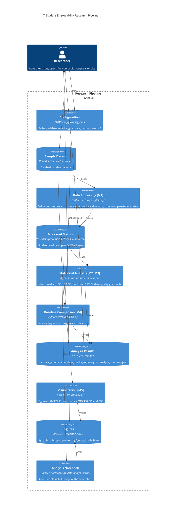

# Domain Model — IT Student Employability Research

## 1. Purpose and scope

This document formalizes the research pipeline that analyzes factors associated with the employability of IT students with little or no professional work experience. Specialization: **Software Engineering (SE)** — the artifact is a C4 container diagram with the measurement nodes marked explicitly.

The model describes a local, script-based data-analysis pipeline. It is not a deployed online application. The threat model for the same components is in [`security_analysis.md`](security_analysis.md).

**Data limitation:** the current dataset (`data/sample/sample.csv`) contains eight synthetic demonstration records. All metrics below test the pipeline; they are not empirical evidence about real students.

## 2. C4 container diagram

Nodes marked **[M1]–[M5]** are the measurement nodes where metrics are produced (see section 3).

## 3. Measurement nodes

| Node | Container | Metrics produced | Output |
|---|---|---|---|
| M1 | Data Processing | Interview invitation rate, job offer rate per application (per student); excluded-record count (printed to console) | `data/processed/metrics_summary.csv` |
| M2 | Statistical Analysis | Mean, median, p95, p99, SD (n−1), bootstrap 95% CI of the mean | `results/statistical_summary.csv` |
| M3 | Statistical Analysis | **Guardrail metrics:** records with missing values, negative counts, invitations > applications, offers > applications | `results/data_quality_summary.csv` |
| M4 | Baseline Comparison | Group rates for internship = yes vs no (baseline comparison) | `results/analysis_summary.json` |
| M5 | Visualization | Group means with bootstrap 95% CI, distributions with median and IQR | `reports/figures/*.png`, `*.pdf` |

## 4. Entities and variables

| Entity | Fields | Role |
|---|---|---|
| Student record | `student_id`, `professional_experience`, `academic_projects`, `internship`, `technical_skills`, `communication_skills` | Independent variables |
| Application outcomes | `applications_sent`, `interview_invitations`, `job_offers` | Counts; applications are the exposure denominator |
| Derived metric | `interview_invitation_rate`, `job_offer_rate_per_application` | Primary and secondary metrics |
| Guardrail | missing-value rate, invalid-record counts | Data-quality checks |

Primary metric: `interview_invitation_rate`. Secondary: `job_offer_rate_per_application`.

## 5. Metric definitions

- **Interview invitation rate** = interview invitations / applications sent (per student).
- **Job offer rate per application** = job offers / applications sent (per student).
- **Pooled rate** = sum of invitations (or offers) over all students / sum of applications over all students.
- **Median, p95, p99** = 50th, 95th and 99th percentiles of the per-student rates (linear interpolation).
- **SD** = sample standard deviation (n − 1).
- **Bootstrap 95% CI** = the 2.5th and 97.5th percentiles of the means of 5000 resamples drawn with replacement (`numpy` generator, seed 42).
- **Missing-record rate** = records with missing values / input records × 100%.

Records with negative counts, or with invitations or offers exceeding applications, are excluded as invalid.

## 6. Data flow and reproducibility

1. `configs/config.yaml` defines paths, variables, metrics and the seed.
2. `src/process_data.py` reads `data/sample/sample.csv`, validates it and writes `data/processed/metrics_summary.csv`.
3. `src/statistical_analysis.py` reads the processed file and writes `results/statistical_summary.csv` and `results/data_quality_summary.csv`.
4. `src/benchmark.py` writes `results/analysis_summary.json` (internship yes vs no).
5. `src/visualize.py` and the notebook write the figures to `reports/figures/`.

All stochastic steps use seed 42.

## 7. Limitations

- Eight synthetic records: percentiles (especially p99) and confidence intervals are illustrative only.
- The analysis is descriptive and exploratory; the internship comparison does not establish causation.
- The current data are survey-style counts, not timed measurements, so the warm-up/benchmark split used in latency studies does not apply to this dataset.
- Results cannot be generalized to the IT student population.
