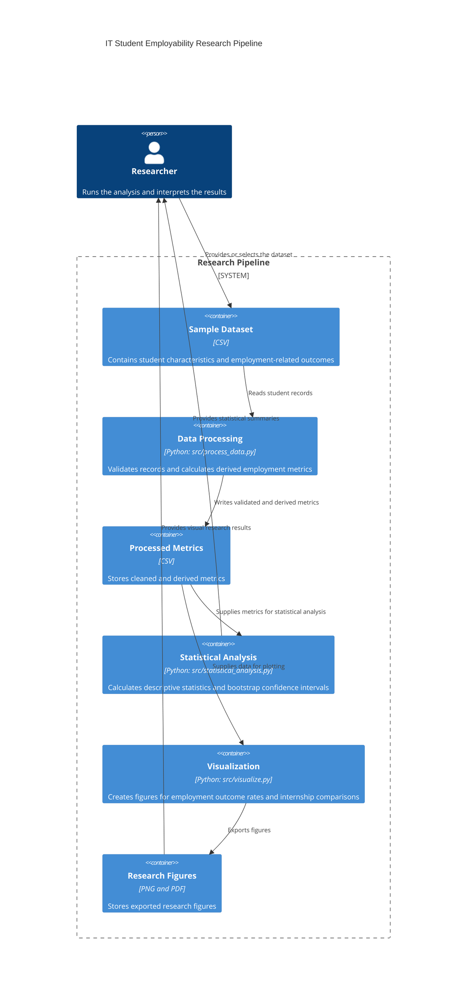

# Domain Model — IT Student Employability Research

## 1. Purpose

This domain model describes the research pipeline used to analyze factors associated with the employability of IT students with little or no professional work experience.

The pipeline processes a sample dataset, calculates employment-related metrics, performs statistical analysis, and generates research visualizations.

**Data limitation:** The current dataset contains eight synthetic demonstration records. It does not represent a real student survey or measured employment outcomes.

## 2. C4-Style Container Diagram

## 3. Metric Collection Points

The following points identify where research variables enter the pipeline and where derived metrics are calculated.

| Collection point | Variables or metrics | Purpose |
|---|---|---|
| Input dataset | Professional experience, academic projects, internship, technical skills, communication skills | Describes student characteristics |
| Application outcomes | Applications sent, interview invitations, job offers | Records employment-related outcomes in the synthetic dataset |
| Data processing | Interview invitation rate, job offer rate per application | Derives comparable outcome measures |
| Statistical analysis | Mean, median, p95, p99, standard deviation, bootstrap 95% confidence interval | Summarizes distributions and uncertainty |
| Visualization | Outcome-rate distributions and internship-group comparison | Communicates analysis results |

The source dataset contains eight synthetic student records. These records must not be interpreted as real observations.

## 4. Main Derived Metrics

Let:

- \(A_i\) be the number of applications sent by student \(i\).
- \(I_i\) be the number of interview invitations received by student \(i\).
- \(O_i\) be the number of job offers received by student \(i\).

For records where \(A_i > 0\), the interview invitation rate is:

\[
R_{I,i} = \frac{I_i}{A_i}\times 100\%
\]

For records where \(A_i > 0\), the job offer rate is:

\[
R_{O,i} = \frac{O_i}{A_i}\times 100\%
\]

These rates describe the synthetic records only. They do not establish causal relationships between student characteristics and employment outcomes.

## 5. Data Flow and Reproducibility

1. Load the sample CSV dataset.
2. Validate records and calculate derived metrics.
3. Save processed metrics to `data/processed/metrics_summary.csv`.
4. Calculate descriptive statistics and bootstrap confidence intervals.
5. Generate and export research figures.
6. Review the outputs and document limitations.

The Python scripts and Jupyter Notebook provide the reproducible analysis workflow.

## 6. Scope and Limitations

- The model describes a local research and data-analysis pipeline, not a deployed online application.
- The current sample contains eight synthetic records.
- The analysis is descriptive and does not demonstrate causation.
- Confidence intervals calculated from this small synthetic sample should not be interpreted as evidence about the broader IT student population.
- The diagram identifies data inputs, processing components, analysis steps, and output artifacts.